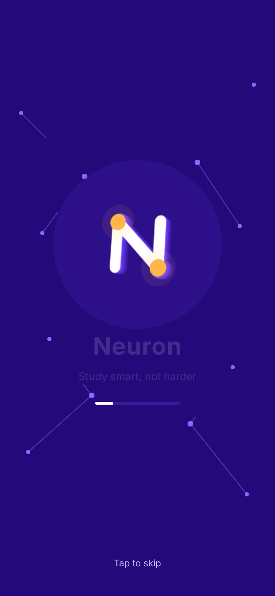
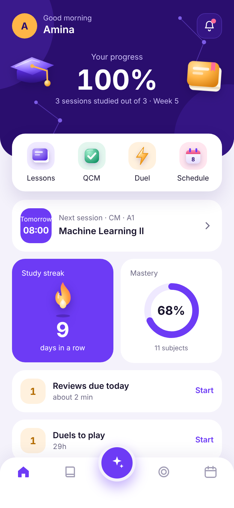
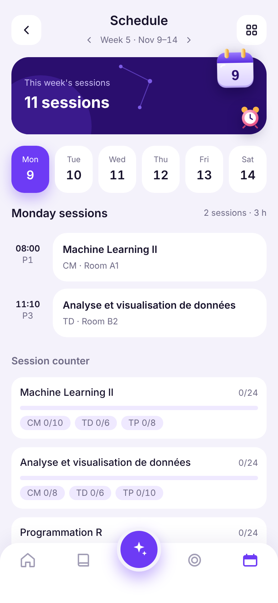
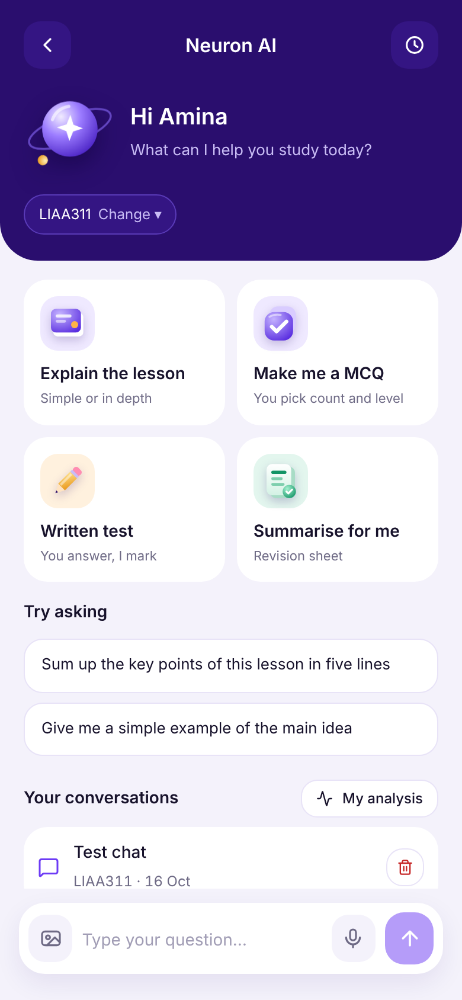
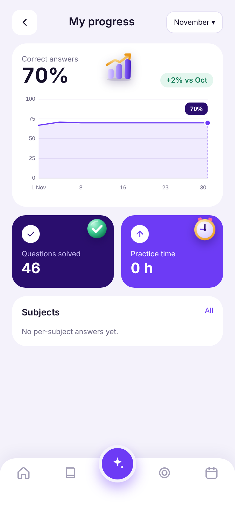
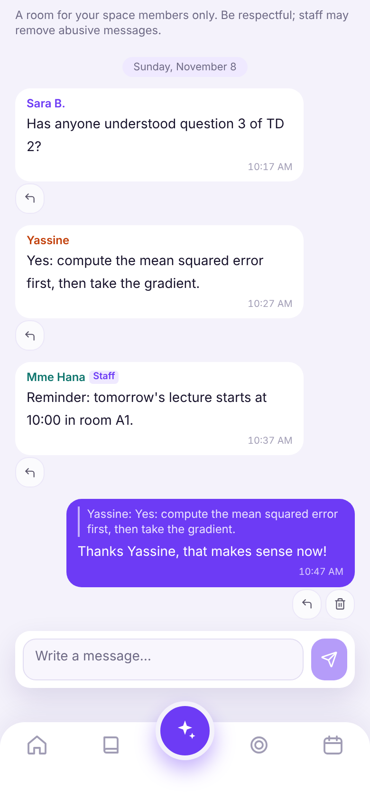
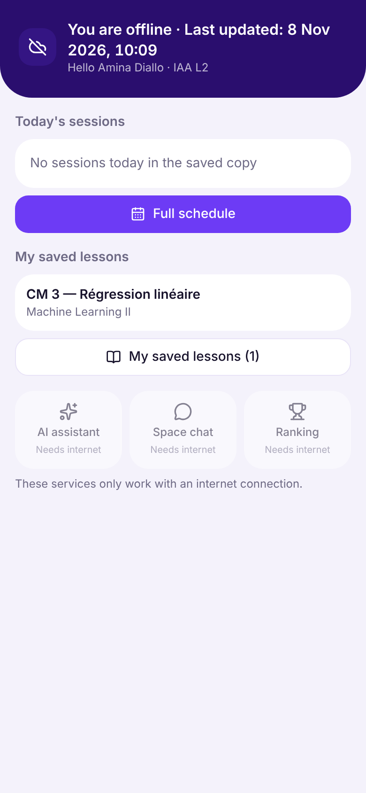
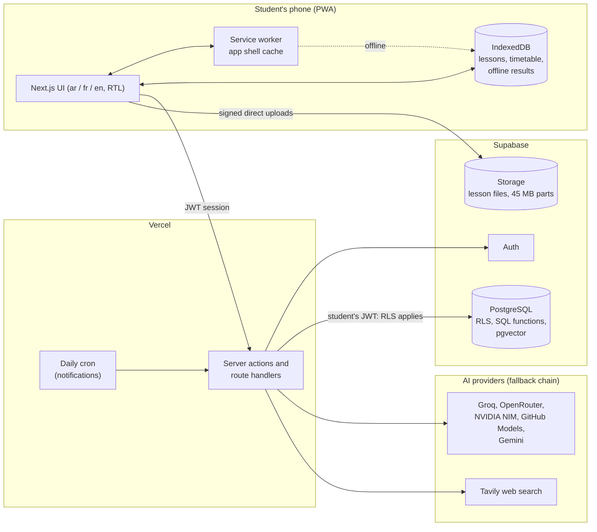

# Neuron

**An offline-first study companion with a course-grounded AI assistant, built for university students in Mauritania, where mobile data is slow and expensive.**

Author: **Med Abdellahi**. I identified the problem, designed the product and its features, made the architecture and privacy decisions, directed the implementation using AI-assisted development (Claude as coding assistant), tested it with real students, and run it in production.

Live app: <https://neuron-flame.vercel.app> (access is limited to enrolled students, so there is no public sign-up; the screenshots below show the real app running on mock data with fictional names).

> **Development started in October 2026. This is a public mirror of the private repository that runs the live platform.** The full commit history is preserved with its original dates. Production keys, student data and internal operational files were removed from every commit, and the author e-mail address was replaced by a GitHub no-reply address. See [SECURITY.md](SECURITY.md) and [LICENSE](LICENSE).


([Higher-quality video: demo.mp4](docs/assets/demo.mp4))

## The problem

University students in Mauritania study on phones, on prepaid mobile data that is both slow and costly. Course material arrives as large PDFs; connections drop during a lecture week; most study tools assume a fast, always-on connection and are not available in the students' languages (Arabic, French and English are all used on campus).

## What I built and why

I wanted one app a student could open on the bus with no signal and still see today's timetable, read a downloaded lesson and practise questions, and that also gives them a patient tutor grounded in *their own* course notes rather than generic web answers.

- **Offline-first PWA**: install once, then cold-start with no connection; lessons, timetable and practice quizzes work offline and sync later.
- **AI assistant grounded in the course**: retrieval-augmented answers with page citations, guided explanations, summaries, personal practice questions, written-answer correction.
- **Practice and motivation**: ranked quizzes, weekly leaderboards, spaced review of mistakes, asynchronous duels between classmates, study streaks.
- **Everything a class needs**: weekly timetable with study-week numbering, announcements, recordings, a moderated space chat, notifications, and admin tools with approval workflow and statistics.
- **Built for the context**: Arabic (right-to-left), French and English, chunked uploads for very large PDFs, and strict privacy rules for anything sent to AI providers.

## How it was built

Neuron was built with AI-assisted development: Claude (by Anthropic) acted as my coding assistant and wrote most of the code under my direction. Many commits carry a `Co-Authored-By` trailer for that reason, and the history is published as it happened.

My role was product owner, designer, tester and operator:

- **Product owner and designer**: I identified the problem (slow, expensive mobile data; large PDFs; three languages on campus), decided which features matter, and made the architecture and privacy decisions (what is stored, what may be sent to an AI provider, who can read what).
- **Director of the implementation**: I described the behavior I wanted, reviewed the results and asked for changes.
- **Tester**: I tested the app with real students and fed back what broke or confused people.
- **Operator**: I run the production deployment and apply the database migrations.

What I learned by doing this:

- **Row Level Security**: how database policies isolate students and spaces from each other, why grading must happen in the database, and how to test those guarantees.
- **Offline-first PWA**: service workers, an app shell cache, IndexedDB and syncing results later.
- **Retrieval-augmented generation (RAG)**: chunking and embedding lessons, retrieval with citations, and keeping answers grounded in the course.
- **Multi-provider AI**: fallback chains across providers and privacy filtering before any text leaves the system.
- **i18n and right-to-left layout**: Arabic, French and English with checks that fail the build when a translation is missing.

## Screens

All screens below are the real application running against a mock backend with fictional names.

| Splash | Home | Schedule |
| :---: | :---: | :---: |
|  |  |  |

| AI assistant | Progress | Space chat |
| :---: | :---: | :---: |
|  |  |  |

| Offline mode (airplane mode, cold start) |
| :---: |
|  |

## Architecture



## Key technical points

- **Row Level Security isolation.** Every table has RLS enabled. A student can only read their own attempts, answers and conversations; spaces (major x level) are isolated from each other by policies built on `my_cohort()`. Grading, scoring and duels run inside `security definer` SQL functions, and `correct_index` / `explanation` are column-protected, so scores and answers cannot be read or forged from the browser. The SQL test suite checks these guarantees, including that migrations are idempotent.
- **Offline-first PWA.** A service worker precaches the complete `/offline` shell per build and replaces the old version only after the new one is fully downloaded. Navigation is network-first with a 3-second timeout, then falls back to a local app backed by IndexedDB. The installed app cold-starts with no network, shows today's sessions and the two-week timetable, opens downloaded lessons (PDF, practice questions with math, summaries), grades practice locally and syncs results when the connection returns. Logging out wipes all local data.
- **Chunked uploads above 50 MB.** Supabase limits an object to 50 MB on the free plan. Files above 45 MB are split in the browser into parts, uploaded directly to Storage with progress, cancel and per-part retry (never through a serverless function), stored as one logical file and verified by hash when joined. Very large PDFs are indexed for the assistant from the browser in small page batches.
- **Multi-provider AI chain with privacy rules.** Requests fall back across five providers. Names, emails and phone numbers are never sent; student text is scrubbed of personal data first; providers that train on prompts are not used (zero data retention / no-training options are enforced where offered, e.g. OpenRouter's data-collection opt-out). A hidden per-student abuse cap and a "pressure mode" keep the free tiers within their limits.
- **Retrieval-augmented answers.** Lessons are chunked and embedded; hybrid semantic plus text search retrieves excerpts, the model cites pages, and answers outside the syllabus are labelled as such.
- **Trilingual UI with RTL.** Arabic, French and English dictionaries (1,050 keys each) are checked at build time: a missing translation, an empty value or an unknown `t("...")` key fails the build.
- **Tests.** 55 unit tests (`node --test`) and 14 SQL suites with 574 assertions run against an in-process PostgreSQL (PGlite) that applies all 28 migrations twice. TypeScript, ESLint and the i18n check run clean, and the production build passes.

## Repository tour

- `src/` the Next.js application (`src/lib/ai`, `src/lib/offline`, `src/lib/i18n` are good starting points)
- `supabase/migrations/` the full database history, 0001 to 0028
- `public/sw.js` the service worker
- `tests/` unit tests and SQL tests

---

# Technical documentation

Neuron is an offline-capable study companion for university students. It is a Progressive Web App (PWA) built with Next.js and Supabase, with an AI assistant grounded in the course material, ranked quizzes, spaced review, a weekly timetable and a space chat. The interface is available in Arabic (right-to-left), French and English.

It was designed for students in Mauritania, where mobile data is slow and expensive: lessons can be downloaded once and used without any connection, and large PDFs are uploaded in chunks.

Live deployment: <https://neuron-flame.vercel.app> (access is limited to enrolled students).

## Features

- **Lessons and progress**: subjects, sessions (CM / TD / TP / summary), PDF files and per-student progress.
- **Practice (Arena)**: free practice, a ranked quiz (20 questions, 20 minutes), weekly and semester leaderboards, written exercises with self-correction.
- **Mistake review**: every wrong answer enters a spaced-review queue (1 day, 3 days, 1 week, 2 weeks, then mastered).
- **Duel**: asynchronous head-to-head quiz between classmates. No result is revealed to either side until both have finished or the 48-hour deadline passes.
- **AI assistant**: retrieval-augmented chat over the published lessons, guided explanation and review sessions, personal summaries and AI-generated QCM, written-answer correction, student analysis.
- **Timetable**: weekly grid with study-week numbering, English-group filtering and "session tomorrow" notifications.
- **Space chat**: one group chat per space, with moderation (delete, mute) and rate limiting.
- **Recordings**: YouTube (privacy-enhanced mode) or Google Drive links for remote sessions.
- **QCM PDF export**: printable question sheets with an answers page.
- **Offline mode**: the installed app opens without internet and keeps lessons, the timetable and practice available (see below).
- **Admin tools**: content approval flow, question import (CSV / Excel / JSON), account import, statistics dashboards, AI provider diagnostics, storage usage.
- **Notifications**: Web Push with per-type preferences.

## Tech stack

| Layer | Technology |
| --- | --- |
| Framework | Next.js 16 (App Router, server actions, `proxy.ts` auth gate), React 19, TypeScript |
| Styling | Tailwind CSS v4, `next-themes` (light / dark), RTL and LTR layouts |
| Database and auth | Supabase (PostgreSQL, Row Level Security, Auth, Storage, `pgvector`) |
| Hosting | Vercel (functions pinned to `dub1`, one daily cron job) |
| AI providers | Groq, OpenRouter, NVIDIA NIM, GitHub Models and Gemini behind one fallback chain; Tavily for web search |
| Documents | `unpdf` (PDF text extraction), `read-excel-file`, `papaparse`, KaTeX, `react-markdown` |
| Tests | `node --test` for pure logic, PGlite (in-process PostgreSQL) for the SQL layer |

### AI provider chain

Requests are tried in order until one succeeds. For personal content (student chat, corrections, analysis) the order is **Groq, OpenRouter, NVIDIA NIM, GitHub Models, Gemini**. For non-personal content (for example generated duel questions) Gemini goes first. The chain is defined in `src/lib/ai/chain-order.ts`.

Privacy rules: names, emails and phone numbers are never sent to a provider; student messages are scrubbed of obvious personal data first; providers that train on prompts are not used; OpenRouter requests opt out of data collection. A per-student hidden abuse cap and a "pressure mode" (lower quotas when daily usage nears the free limits) protect the free tiers.

## Folder structure

```
src/proxy.ts                 Session refresh and redirect to the login page
src/app/(app)/...            Protected pages (home, subjects, practice, schedule, profile, assistant, chat, admin)
src/app/actions/...          Server actions (all writes go through here or through SQL functions)
src/app/api/...              Route handlers (AI chat, cron, offline sync, space chat)
src/components/...           UI components
src/lib/ai/...               Provider clients, fallback chain, RAG, prompts, privacy filter, diagnostics
src/lib/offline/...          IndexedDB layer, local grading, sync of offline results
src/lib/i18n/...             Dictionaries (ar / fr / en) and translators
public/sw.js                 Service worker (offline app shell)
supabase/migrations/...      Schema, RLS policies and SQL functions (0001 ... 0028)
scripts/                     Admin creation, icon generation, i18n check
tests/                       Unit tests (tests/*.test.mjs) and SQL tests (tests/sql/phase*.mjs)
.github/workflows/           Keep-alive ping and a fallback for the daily notification job
```

## Run locally

Requirements: Node.js 22 or newer and a Supabase project (the free tier is enough).

```bash
npm install
# create .env.local with the variables listed in the next section
npm run dev                    # http://localhost:3000/login
```

Create the first admin account once (it reads the keys from `.env.local`):

```bash
node --env-file=.env.local scripts/create-admin.mjs "Full Name" you@example.com 'a-strong-password'
```

From the admin panel you can then create moderators and students.

## Environment variables

Only the **names** are listed here. Values belong in `.env.local` (never committed) and in the Vercel project settings. `SUPABASE_SERVICE_ROLE_KEY` bypasses RLS: keep it server-side and never share it.

| Variable | Required | Purpose |
| --- | --- | --- |
| `NEXT_PUBLIC_SUPABASE_URL` | yes | Supabase project URL |
| `NEXT_PUBLIC_SUPABASE_ANON_KEY` (or `NEXT_PUBLIC_SUPABASE_PUBLISHABLE_KEY`) | yes | Public client key |
| `SUPABASE_SERVICE_ROLE_KEY` | yes | Server-only key for admin actions and indexing |
| `APP_TIMEZONE` | recommended | Time zone for "today", "now" and the weekly ranking (for example `Africa/Nouakchott`) |
| `MULTI_SPACE_ENABLED` | no | `true` re-enables multi-space mode (see below) |
| `GROQ_API_KEY`, `OPENROUTER_API_KEY`, `NVIDIA_API_KEY`, `GITHUB_MODELS_TOKEN`, `GEMINI_API_KEY` | at least one | AI providers |
| `TAVILY_API_KEY` | no | Web search for the assistant |
| `GEMINI_MODEL`, `GEMINI_EMBEDDING_MODEL`, `GROQ_MODEL`, `GROQ_VISION_MODEL`, `RAG_MIN_SIMILARITY` | no | Model and retrieval tuning |
| `AI_LIMIT_<PROVIDER>_DAILY` | no | Approximate daily request limits used by pressure mode and the usage bars |
| `VAPID_PUBLIC_KEY`, `VAPID_PRIVATE_KEY`, `VAPID_SUBJECT` | for push | Web Push keys (generated from the admin panel) |
| `CRON_SECRET` | for push | Protects `/api/cron/notify` |
| `STORAGE_LIMIT_BYTES` | no | Storage quota shown on the admin storage card |

GitHub Actions secrets (only for the two workflows): `SUPABASE_URL`, `SUPABASE_ANON_KEY`, `SITE_URL`, `CRON_SECRET`.

## Database migrations

Run the files in `supabase/migrations/` in numeric order from the Supabase SQL Editor: `0001`, `0002`, ... up to `0028`. Every file after `0002` is idempotent and safe to run twice.

**Never re-run `0002_grants.sql` after `0003`.** Its blanket `select` grant would undo the column-level protection of `questions.correct_index` and `questions.explanation`. If that ever happens, re-run the `revoke select ... / grant select (...)` statements at the top of `0003`.

Highlights:

| Range | Content |
| --- | --- |
| 0001 - 0004 | Core schema, grants, Arena (attempts, scoring, ranking, spaced review), keep-alive ping |
| 0005 - 0009 | AI assistant: RAG chunks, conversations, guided sessions, usage limits, last provider errors |
| 0010 - 0013 | Recordings, announcements, Duel, push notifications, admin statistics |
| 0014 - 0016 | English locale, semester start date, QCM PDF export |
| 0017 - 0020 | Spaces (major x level), RLS isolation per space, dashboards, remaining subjects |
| 0021 - 0024 | AI platform: abuse guard, space chat, personal QCM, AI-generated duels |
| 0025 - 0028 | Offline score sync, file-size limit removal, single-space mode, multipart files |

`0027_single_space_down.sql.txt` is a manual rollback for `0027` and is never run automatically.

## Single space and the `MULTI_SPACE_ENABLED` switch

A "space" is a major x level (for example "IAA L2"): a row in `cohorts` with its own subjects, timetable, announcements, ranking and a set of plan features. RLS isolates spaces from each other in the database.

The platform currently runs a single space. With `MULTI_SPACE_ENABLED` unset or `false` there is no space choice at login, no space management page and no space switcher. The multi-space code stays in the repository and is re-enabled by setting `MULTI_SPACE_ENABLED=true`. Migration `0027` makes every other space inactive without deleting anything.

## Offline mode

- A service worker (`public/sw.js`) downloads the full `/offline` app shell (HTML, JS, CSS, fonts, icons, manifest) into a cache named after the build. A new version replaces the old one only after its shell has been downloaded completely.
- Navigation is network-first with a three-second timeout, then falls back to the local shell, so the installed app cold-starts with no connection.
- User-specific pages are never cached by the service worker. Personal data lives in IndexedDB on the device and is wiped on logout or account switch.
- Students can download lesson packs (PDFs and QCM sets). Offline QCM results are graded locally and queued; they are synced later through `record_offline_scores` (practice only, never the ranking).
- The offline banner is hidden inside the local app, which already runs without a network.

## Large file upload

Supabase Storage limits an object to 50 MB on the free plan. Files above 45 MB are split in the browser into parts of at most 45 MB, uploaded directly to Storage with progress and per-part retry (so they never pass through a serverless function), and stored as one logical file (`part_count > 1`, `<lessonId>/<fileId>/part-001 ...`). Part hashes are verified when the parts are joined for viewing. Large PDFs are indexed for the assistant from the browser in small page batches, so no request exceeds the function time limit.

## Tests

```bash
npm test               # unit tests (node --test)
npm run test:sql       # SQL layer: applies all migrations in PGlite (twice, to check idempotency) and checks RLS, grants and functions
npm run check:i18n     # every key exists in ar / fr / en, no empty value, every t("...") call resolves
npx tsc --noEmit       # type check
npx eslint .           # lint
npm run build          # production build (runs check:i18n first)
```

## Deployment

1. Create the Supabase project, run the migrations in order, and add the Redirect URL `https://<your-domain>/auth/callback` under Authentication > URL Configuration.
2. Import the repository in Vercel and set the environment variables above. `vercel.json` pins functions to `dub1` (close to Supabase `eu-west-1`) and schedules `/api/cron/notify` daily at 17:00 UTC.
3. Create the first admin with `scripts/create-admin.mjs`.
4. Optional: add the GitHub Actions secrets so `keep-alive.yml` pings the database every three days (free Supabase projects pause when idle). `notify-backup.yml` is a manual or scheduled fallback if Vercel Cron is unavailable on your plan.
5. After uploading old PDFs, use "Re-index all" in the admin AI panel to build the assistant's search index.

Other operational notes: the subject and semester catalog is cached for one hour (`src/lib/catalog.ts`); session verification uses `getClaims()`, which is local (no network call) when the Supabase project uses asymmetric JWT signing keys.

## Design notes

- **Phone login**: a phone number is only an identifier (no SMS). It is mapped to an internal email `<digits>@phone.neuron.local`, and the last 8 digits are matched at login.
- **Publishing**: content uploaded by a moderator is "pending approval" (database trigger) unless the moderator has the direct-publish permission. Students only see published content (RLS).
- **Server-side grading**: answers are graded by SQL functions (`submit_answer`, `duel_answer`, ...). Students cannot read `correct_index` or `explanation` and cannot write to attempt tables directly, so scores cannot be forged from the browser.
- **Next.js 16**: `middleware` is now `src/proxy.ts`, and Cache Components are disabled because every page is behind login.

## License

All rights reserved (see LICENSE). The production system is private and serves real students.
